<p align="center">
  
</p>

<p align="center"><b>A protocol bridge that connects Kiro to A2A agents and their sub-agents.</b></p>

<p align="center">
  
  
  
  
</p>

<p align="center">
  
</p>

## Overview

Kiro reaches external systems only through **MCP**. Agents built on **A2A** accept only A2A
tasks. The two protocols are not compatible, so Kiro cannot call an A2A agent or any of its
sub-agents directly.

`kiro-a2a-bridge` is an adapter between the two. It runs locally as an MCP server started by Kiro,
exposes each A2A agent as a Kiro tool, and translates calls into A2A tasks, including sign-in,
progress streaming, agent questions and follow-up conversations. Neither Kiro nor the agents
need to change.

## Background

| Protocol | Connects | Role in this project |
|---|---|---|
| **MCP** (Model Context Protocol) | an AI application and its tools | the only way Kiro calls out |
| **ACP** (Agent Client Protocol) | an editor and a coding agent | how a client drives Kiro CLI (`kiro-cli acp`) |
| **A2A** (Agent2Agent) | agents and other agents | how the orchestrator and sub-agents work together |

<p align="center">
  
</p>

### Where MCP and ACP sit inside Kiro

A common question is whether Kiro first speaks ACP and then MCP. It depends on how Kiro is used,
but **the call to your agent always leaves Kiro over MCP**:

<p align="center">
  
</p>

- **Kiro IDE or `kiro-cli chat`** (most users): there is no ACP. You type in Kiro, Kiro's agent
  picks the `ask_<agent>` tool, and calls `kiro-a2a` over MCP. Kiro starts `kiro-a2a` itself
  from `.kiro/settings/mcp.json`, which `kiro-a2a add` writes for you.
- **An editor driving `kiro-cli acp`**: the editor sends the prompt into Kiro over ACP. Inside
  Kiro the same agent runs, and its call to your agent still goes out over MCP through
  `kiro-a2a`.

In short: **ACP** is how a client talks *to* Kiro, **MCP** is how Kiro talks *out* (to tools and
to `kiro-a2a`), and **A2A** is how `kiro-a2a` talks to your agents. Kiro never speaks A2A itself,
which is the gap this project closes.

What happens on one request in the Kiro IDE:

1. On start, Kiro reads `mcp.json` and launches `kiro-a2a mcp` as a local process (stdio).
2. Kiro asks it for its tools (`tools/list`); `kiro-a2a` reads each agent card and returns
   `ask_orchestrator`, etc.
3. You ask *"Ask the orchestrator to …"*; Kiro's model chooses that tool (`tools/call`).
4. `kiro-a2a` signs in if needed and sends an A2A task to the orchestrator over HTTPS.
5. The orchestrator delegates to its sub-agents over A2A; progress streams back to Kiro as MCP
   progress notifications.
6. The final answer returns to Kiro as the tool result and appears in the chat.

## The problem

<p align="center">
  
</p>

Kiro has no A2A client. In particular, it cannot:

- convert a tool call into an A2A task with a lifecycle (working, input-required, completed);
- discover agents through their agent cards;
- sign in to protected agents (OAuth 2.0 / OpenID Connect, company certificates);
- receive streamed progress;
- keep a conversation (`contextId`) or answer an agent's question on the same task.

**Options considered:** rewriting agents as MCP servers (loses A2A and breaks other callers),
one wrapper per agent (duplicated effort), waiting for native A2A support in Kiro (no timeline),
and a single generic bridge. The generic bridge was chosen: no changes to agents or Kiro, and one
place for sign-in, streaming and error handling.

## Architecture

### High level

<p align="center">
  
</p>

The bridge runs on the developer workstation, is started by Kiro, and makes outbound HTTPS calls
only. The same package also provides two reverse directions: Kiro CLI as an A2A agent
(`serve`), and A2A agents for editors that host ACP agents (`acp`).

### Low level

<p align="center">
  
</p>

| Kiro / MCP | A2A |
|---|---|
| `tools/list` | agent card (one tool per agent: `ask_<name>`) |
| `tools/call` | `SendStreamingMessage` (1.0) / `message/stream` (0.3) |
| `context_id`, `task_id` arguments | `contextId`, `taskId` |
| progress notifications | `status-update` (working) |
| tool result | artifacts (answer, then file diffs) |
| result with `task_id` | `input-required` |
| tool error with guidance | failed, rejected, 401, unreachable |

### End-to-end flow

<p align="center">
  
</p>

## Getting started

**Requirements:** Python 3.10+, Kiro (IDE or CLI), and the URL of an A2A agent.

```bash
pip install kiro-a2a-bridge
kiro-a2a add orchestrator https://agents.example.com/orchestrator --global
kiro-a2a login orchestrator      # only if the agent requires interactive sign-in
kiro-a2a doctor
```

`add` registers the agent with Kiro (`--global` for all projects, otherwise the current project).
Then open a folder in Kiro: the agent appears under **MCP servers**, and you can ask
*"Ask the orchestrator to …"*. With Kiro CLI: `kiro-cli chat --agent orchestrator`.

To add sub-agents as separate tools, run `add` for each. To remove an agent:
`kiro-a2a remove orchestrator --global`.

**Example agents:** [`examples/langgraph-team`](https://github.com/manoj-maharana/kiro-a2a-bridge/tree/main/examples/langgraph-team)
contains a LangGraph orchestrator with two sub-agents, served with the official A2A SDK.

<table>
<tr>
<td width="33%">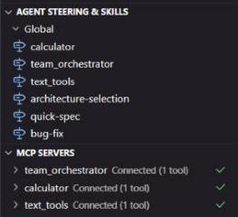<br><sub>Agents connected in Kiro</sub></td>
<td width="33%">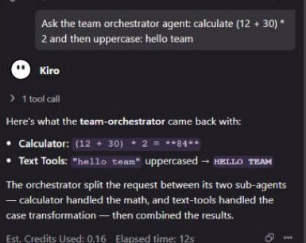<br><sub>Delegation to sub-agents</sub></td>
<td width="33%">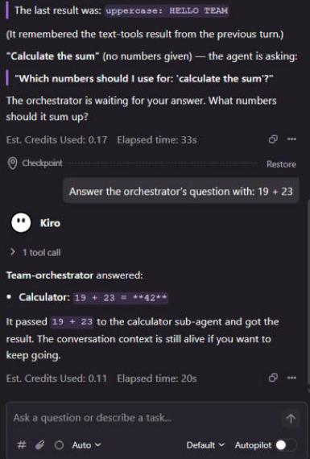<br><sub>Agent question and resume</sub></td>
</tr>
</table>

## Sign-in

The sign-in method is read from the agent card where possible. It can also be set explicitly:

```bash
# Interactive sign-in (OpenID Connect with PKCE)
kiro-a2a add reviewer https://agents.example.com/reviewer -g \
  --client-id <client-id> --issuer https://login.example.com/<tenant>/v2.0 --scope <scope>

# Service account; the secret is read from an environment variable
kiro-a2a add builder https://agents.example.com/builder -g \
  --client-id <client-id> --client-secret-env BUILDER_SECRET --token-url https://login.example.com/oauth2/token
```

Secrets are stored as `${ENV_VAR}` placeholders, never as values. Tokens are cached per user and
refreshed automatically. See the [configuration reference](https://github.com/manoj-maharana/kiro-a2a-bridge/blob/main/docs/configuration.md).

## Commands

| Command | Purpose |
|---|---|
| `add NAME URL [-g]` | Register an A2A agent with Kiro |
| `list [-g]` / `remove NAME [-g]` | List or remove registered agents |
| `login NAME` / `logout NAME` | Manage sign-in for an agent |
| `doctor` | Check agent cards, sign-in and Kiro CLI |
| `ask NAME "message"` | Call an agent from the terminal |
| `card NAME` | Show an agent card and verify its signature |
| `serve` | Expose Kiro CLI (or another ACP agent) as an A2A agent |
| `acp` | Expose an A2A agent to ACP editors |

## Security

- No secrets in configuration files; environment variable placeholders only.
- Per-user token store; PKCE for interactive sign-in; callback bound to `127.0.0.1`.
- Outbound HTTPS only; no inbound ports on the workstation.
- Optional verification of signed agent cards.
- Agent responses become part of the Kiro conversation and are subject to Kiro's data settings.

## Validation

- End-to-end in the Kiro IDE: delegation to sub-agents, follow-ups, interactive sign-in, and an
  agent question answered mid-task.
- Interoperability with the official A2A Python SDK (A2A 1.0) and LangGraph agents.
- 52 automated tests on Windows, macOS and Linux, including failure cases.

## Development

```bash
git clone https://github.com/manoj-maharana/kiro-a2a-bridge
cd kiro-a2a-bridge
pip install -e ".[dev]"
pytest
```

Further reading: [How it works](https://github.com/manoj-maharana/kiro-a2a-bridge/blob/main/docs/how-it-works.md) ·
[Contributing](https://github.com/manoj-maharana/kiro-a2a-bridge/blob/main/CONTRIBUTING.md) ·
[Security](https://github.com/manoj-maharana/kiro-a2a-bridge/blob/main/SECURITY.md) ·
[Changelog](https://github.com/manoj-maharana/kiro-a2a-bridge/blob/main/CHANGELOG.md)

## License

MIT
